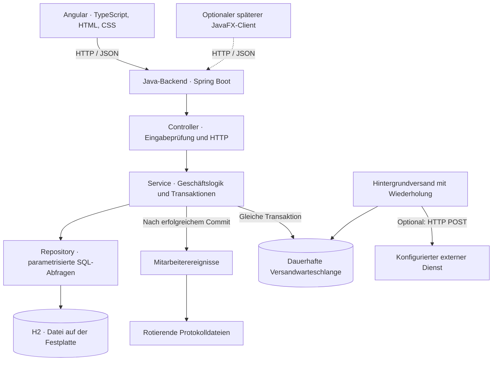

# Personalmanagement Online

Kurz: PEM Online

Eigenständige Anwendung mit Angular-Frontend, Java-/Spring-Boot-Backend, HTTP-API und einer dauerhaft gespeicherten H2-Datenbank. Dieses Repository enthält das vollständige Projekt und kann unabhängig von anderen Projekten gebaut und gestartet werden.

Der sichtbare Produktname lautet **Personalmanagement Online**. Der Projektordner und die technischen Kennungen heißen `pemonline`, die Java-Pakete beginnen mit `de.pemonline`. Der Einstiegspunkt ist `PemonlineApplication`.

## Schnellstart unter Windows

Voraussetzungen: **JDK 25 oder neuer**, Git, PowerShell sowie **Docker mit Compose** für die Keycloak-Anmeldung. Docker Desktop vor dem Start öffnen. Maven, Node.js und die Frontend-Abhängigkeiten werden beim ersten Build automatisch heruntergeladen; dafür ist Internetzugriff erforderlich.

```powershell
git clone https://github.com/TobiasKTK/Personalmanagement-Online.git pemonline
cd pemonline
.\Keycloak.ps1
.\Starten.ps1
```

Nach der Meldung `Started PemonlineApplication` im Browser <http://127.0.0.1:8080> öffnen und **Mit Keycloak anmelden** wählen. Für die mitgelieferte lokale Umgebung lautet der Benutzername `admin`. Das zufällig erzeugte Startpasswort steht in der lokalen Datei `.env` unter `PEM_KEYCLOAK_APP_PASSWORD`; beim ersten Login muss es geändert werden. Die Datei `.env` wird nicht in Git aufgenommen.

Das Repository enthält keine lokalen Betriebsdaten oder persönlichen Zugangsdaten. Die Anwendung speichert ihre Daten standardmäßig unter `%LOCALAPPDATA%/pemonline`; Keycloak verwendet das Docker-Volume `pemonline_keycloak-data`. Für eine getrennte Anwendungsdatenbank `Starten.ps1 -DatenVerzeichnis <eigener-leerer-Ordner>` verwenden. Weitere Hinweise stehen unter [Anmeldung und erste Einrichtung](#anmeldung-und-erste-einrichtung) und [Dauerhafte Daten und Sicherungen](#dauerhafte-daten-und-sicherungen).

In VS Code `pemonline.code-workspace` öffnen. Alle weiteren Befehle in dieser Anleitung gehen vom Wurzelordner dieses Repositorys aus. **Strg+C** beendet die Anwendung; `.\Keycloak.ps1 -Stoppen` beendet den lokalen Keycloak-Dienst und erhält dessen Daten.

## Oberfläche und Bedienung

Die Oberfläche verwendet neutrale Flächen und Blau für primäre Aktionen und die aktive Navigation. Grün bleibt für Erfolg und fachliche Statusanzeigen erhalten; destruktive Aktionen sind rot. Die Navigation ist in **Übersicht & Planung**, **Personal** und **Verwaltung** gegliedert und berücksichtigt weiterhin die Kontorechte. Auf schmalen Bildschirmen wird sie über **Menü** geöffnet. Escape schließt das Menü und führt den Tastaturfokus zurück; nach einer Navigation steht der Fokus im Inhalt. Die Kopfzeile zeigt die aktuelle Firma und ihre ID.

Die Startübersicht trennt aktuelle Abwesenheiten, Freigaben und den eigenen Urlaub von den anstehenden Ein- und Austritten. Tabellen bleiben horizontal scrollbar, ohne die gesamte Seite zu verbreitern. Bei sehr kleinen Bildschirmen scrollt die Aktionsspalte mit, damit sie die Daten nicht verdeckt. Der Mitarbeiterdialog ordnet seine Felder je nach verfügbarem Platz in einer, zwei oder drei Spalten an. Eine erfolglose Teamsuche bietet direkt das Zurücksetzen der Filter an.

Gemeinsame Farben, Abstände, Rundungen und die Schriftfamilie stehen in `src/main/resources/static/anmeldung/design-tokens.css`. Anmeldung und Angular importieren dieselben Werte. Wiederkehrende Komponenten werden in `frontend/src/styles.css`, der Anwendungsrahmen in `frontend/src/styles/shell.css` gestaltet. `frontend/tests/ui-design.spec.ts` prüft die Fachansichten bei 320, 768, 1024 und 1440 Pixeln sowie das mobile Menü, Tastaturbedienung, den Mitarbeiterdialog und die leere Suche. Die Browsertests erzeugen Screenshots im jeweiligen `frontend/test-results`-Unterordner.

## Anmeldung und erste Einrichtung

Die Anmeldung erfolgt standardmäßig über **Keycloak** mit OpenID Connect (Authorization Code und PKCE/S256). Unter `/login` führt **Mit Keycloak anmelden** zum zentralen Anmeldeformular. Passwörter, E-Mail-Adressen, Passwortzurücksetzen und gegebenenfalls Mehrfaktor-Anmeldung verwaltet Keycloak. Die Anwendung erhält keine Benutzerpasswörter. Tokens bleiben auf dem Server; Angular verwendet weiterhin ein HttpOnly-Sitzungscookie.

Die Startseite für die Anmeldung funktioniert ohne JavaScript; die Fachoberfläche benötigt JavaScript. Spring Security prüft Signatur, Aussteller, Empfänger und Nonce des ID-Tokens. Anmeldeseiten werden nicht zwischengespeichert.

Für die lokale Umgebung werden Java 25 sowie Docker mit Compose benötigt. Docker Desktop zuerst starten, dann im Ordner `pemonline`:

```powershell
.\Keycloak.ps1
.\Starten.ps1
```

`Keycloak.ps1` ergänzt fehlende Startpasswörter in der von Git ausgeschlossenen Datei `.env`, erhält vorhandene Einstellungen und Passwörter, startet Docker Compose und wartet auf den Realm. Die Passwörter werden nicht ins Terminal geschrieben. Anwendung: [http://127.0.0.1:8080], Benutzer **admin**, Startpasswort aus `PEM_KEYCLOAK_APP_PASSWORD` in `.env`; Keycloak verlangt beim ersten Login ein neues Passwort. Keycloak-Verwaltung: [http://127.0.0.1:8180], Benutzer **keycloak-admin**, Passwort aus `PEM_KEYCLOAK_ADMIN_PASSWORD`. Die beiden Konten sind getrennt. Nach einer Passwortänderung gilt das neue Passwort; `.env` enthält nur die ursprünglichen Startpasswörter.

Keycloak speichert seine Daten im Docker-Volume `pemonline_keycloak-data`. `.\Keycloak.ps1 -Stoppen` beendet den Dienst und erhält die Daten. Der Realm-Import wird nur bei einem noch nicht vorhandenen Realm ausgeführt. Änderungen an `keycloak/pemonline-realm.json` überschreiben vorhandene Realms daher nicht. Die Compose-Umgebung verwendet `start-dev` und ist ausschließlich für lokale Entwicklung auf der Loopback-Adresse vorgesehen. Die H2-Sicherung von pemonline enthält keine Keycloak-Daten; das Docker-Volume muss separat gesichert werden.

**Bestehende Konten übernehmen:** Kontonamen, Rollen, Firmenzugänge und Mitarbeiterzuordnungen bleiben erhalten. Es gibt keine automatische Passwortmigration. In Keycloak für jede Person ein Benutzerkonto erstellen, ein neues Passwort bzw. eine Einladung einrichten und dessen Attribut **pemonline-Kontoname** (`pemonline_konto`) auf den exakten bestehenden Kontonamen setzen. Nur die Keycloak-Administration darf dieses Attribut bearbeiten. Bei einem bisherigen Administrator mit anderem Namen als `admin` muss die Zuordnung entsprechend angepasst werden. `MITARBEITER_ADMIN_NAME` wird nur bei einer leeren pemonline-Datenbank ausgewertet (Standard `admin`); im Keycloak-Modus wird kein lokales Passwort benötigt oder erzeugt.

**Neue Zugänge:** Unter **Konten → Firmenzugänge** Name, Rolle und Aktivierung anlegen. Danach das Keycloak-Benutzerkonto über `pemonline_konto` zuordnen. Jeder pemonline-Kontoname darf nur einer Person zugeordnet werden. Der signierte ID-Token muss diesen einzelnen String enthalten. Fehlende, unbekannte, gesperrte Konten oder Konten ohne aktiven Firmenzugang (und ohne Systemverwaltungsrechte) werden abgewiesen. E-Mail-Adressen, `preferred_username` und Keycloak-Rollen verleihen keine pemonline-Rechte. Die mitgelieferte Realm-Konfiguration schützt das Zuordnungsattribut vor Benutzeränderungen und deaktiviert Selbstregistrierung sowie Passwort- und Implicit-Grant.

**Verbindung konfigurieren:** `PEM_KEYCLOAK_ISSUER` (Standard `http://127.0.0.1:8180/realms/pemonline`), `PEM_KEYCLOAK_CLIENT_ID` (Standard `pemonline`) und optional `PEM_KEYCLOAK_CLIENT_SECRET` für einen vertraulichen Client. Der lokale Client ist öffentlich und erzwingt PKCE. Andere Hosts/Ports, etwa `Starten.ps1 -Port 8082` oder Angular auf Port 4200, benötigen in Keycloak unter Clients → pemonline die jeweilige exakte Redirect-URI `http://127.0.0.1:PORT/login/oauth2/code/keycloak` und Post-Logout-URI `http://127.0.0.1:PORT/login?abgemeldet`. Browser und Konfiguration müssen denselben Host verwenden, also nicht zwischen `localhost` und `127.0.0.1` wechseln.

Die lokale Sitzung läuft nach 30 Minuten Inaktivität ab. **Abmelden** beendet sie sofort und leitet den Browser zur Keycloak-Abmeldung weiter. Firmenwechsel behalten die OIDC-Identität für diesen Logout bei. Lokale Rechteänderungen und Sperren entziehen bestehenden Sitzungen weiterhin den Zugriff. Eine Sperre oder Passwortänderung ausschließlich in Keycloak beendet eine bereits vorhandene pemonline-Sitzung nicht unmittelbar; Backchannel-Logout ist nicht eingerichtet. Bei sofortigem Entzug auch das pemonline-Konto sperren. Für Passwort-E-Mails muss SMTP im Keycloak-Realm eingerichtet werden; die bisherigen `PEM_SMTP_*`-Variablen richten Keycloak nicht ein.

Beispiel: pemonline-Kontoname `personalverwaltung`, Rolle **Personalverwaltung**, zugehöriges Keycloak-Attribut `pemonline_konto=personalverwaltung`. Kontonamen enthalten 3–80 Zeichen (`a-z`, Ziffern, Punkt, Unterstrich, Bindestrich). Passwortrichtlinien werden im Keycloak-Realm festgelegt.

| Rolle | Rechte |
| --- | --- |
| Lesen | Mitarbeiter, gefilterte Statistiken, Organisationseinheiten, Teamkalender und Startübersicht lesen; eigene Urlaubsanträge, Benachrichtigungen und eigenen ICS-Export nutzen |
| Personalverwaltung | Zusätzlich Mitarbeiter, Urlaubskonten und Abwesenheiten pflegen; zuständige Anträge entscheiden; Verlauf lesen und gefilterte Teamdaten exportieren |
| Administration | Zusätzlich Organisationseinheiten, lokale Konten, Mitarbeiterkontenzuordnung, Vertretungen, Feiertagskalender und Besetzungsregeln verwalten |

Zugriffe werden serverseitig sowohl an den HTTP-Endpunkten als auch an den geschützten Service-Methoden geprüft. Schreibende Anfragen einschließlich Logout benötigen einen CSRF-Nachweis. Angular sendet ihn über `X-XSRF-TOKEN`; den OIDC-Login schützen State, Nonce und PKCE. Das Sitzungscookie verwendet `SameSite=Lax`, damit der Rücksprung von Keycloak funktioniert. Die Anwendung bleibt standardmäßig auf `127.0.0.1` beschränkt. Für Betrieb über HTTPS `MITARBEITER_HTTPS=true` setzen. Eine externe Veröffentlichung benötigt eine passende HTTPS-Bereitstellung; diese ist nicht Teil der lokalen Anwendung.

## E-Mail und Passwortwiederherstellung

Dieser Abschnitt beschreibt die **lokale Anmeldung** (`PEM_ANMELDUNG=lokal`). Bei der Keycloak-Anmeldung verwaltet Keycloak die E-Mail-Bestätigung und Passwortwiederherstellung; die lokalen Formulare sind dort ausgeschaltet.

Unter **Meine E-Mail** in der Kopfzeile kann jeder angemeldete Benutzer seine eigene Adresse hinterlegen. Dafür ist das aktuelle Passwort erforderlich. Erst nach Öffnen des Bestätigungslinks und Betätigen von **E-Mail bestätigen** ist die Adresse für Anmeldung und Wiederherstellung freigeschaltet. Ein erneuter Versand erfolgt durch erneute Eingabe derselben Adresse und des aktuellen Passworts. Bestätigungslinks gelten 24 Stunden; nur der zuletzt angeforderte Link gilt. Bei einem Adresswechsel bleibt die bisher bestätigte Adresse bis zur Bestätigung der neuen gültig. Die bisherige Adresse erhält anschließend eine Änderungsnachricht.

Die Adresse gehört zum **globalen Konto**, nicht zu einer Firma oder einem Mitarbeiterdatensatz. Sie ist einschließlich ausstehender Bestätigungen über alle Firmen hinweg eindeutig. Unbestätigte Reservierungen verfallen nach 24 Stunden. E-Mail-Adressen werden ohne führende/abschließende Leerzeichen und ohne Unterscheidung von Groß-/Kleinschreibung verglichen; Punkt- und Plus-Aliase werden nicht zusammengeführt. Unterstützt werden ASCII-Adressen, internationale Domains in Punycode-Schreibweise. Kontonamen und vorhandene Firmenzuordnungen bleiben unverändert. Neue Konten werden weiterhin durch die Administration mit Kontonamen angelegt; die Benutzer ergänzen danach ihre eigene E-Mail-Adresse.

**Passwort vergessen:** E-Mail-Adresse oder Kontoname eingeben. Für aktive Konten mit bestätigter Adresse wird ein einmaliger Rücksetzlink mit 30 Minuten Gültigkeit versendet. Die Rückmeldung verrät nicht, ob ein Konto existiert. Das neue Passwort gilt für alle Firmenzugänge; bestehende Sitzungen und noch offene Bestätigungs-/Rücksetzlinks werden ungültig. Das Passwort wird weder angezeigt noch per E-Mail verschickt. Nach der Änderung folgt eine Benachrichtigung und eine reguläre Neuanmeldung. Ohne bestätigte Adresse oder Zugriff auf das Postfach bleibt die Administration zuständig; für firmenübergreifende Konten gelten weiterhin die Rechte der Systemverwaltung.

Anfragen werden begrenzt: maximal drei Rücksetz-E-Mails pro Konto und Stunde, zehn Rücksetzanfragen pro Gegenstellen-IP in 15 Minuten, fünf Bestätigungsanfragen pro Konto und Stunde sowie 30 Linkeinlösungen pro IP in 15 Minuten. Hinter einem Reverse Proxy wird die direkte Gegenstelle gezählt, kein ungeprüfter Forwarded-Header. Für größere Installationen dort zusätzlich passende Begrenzungen je Client konfigurieren. Der Versand von Rücksetzlinks läuft in einer begrenzten Warteschlange; SMTP-Zeiten und Kontosuche beeinflussen die öffentliche Rückmeldung nicht. Bei einem Neustart werden wartende Aufträge nicht dauerhaft übernommen; dann erneut anfordern. SMTP-Fehler werden ohne Adressen, Links oder Zugangsdaten protokolliert.

### SMTP einrichten

Standardmäßig ist der Versand ausgeschaltet. Sobald ein Mailserver verfügbar ist, diese Werte in der lokalen Startumgebung konfigurieren (keine Zugangsdaten ins Repository schreiben):

```powershell
$env:PEM_KONTO_MAIL_AKTIV = 'true'
$env:PEM_ANMELDUNG = 'lokal'
$env:PEM_BASIS_URL = 'https://pem.example.org'
$env:PEM_MAIL_ABSENDER = 'pem@example.org'
$env:PEM_SMTP_HOST = 'smtp.example.org'
$env:PEM_SMTP_PORT = '587'
$env:PEM_SMTP_BENUTZER = 'pem@example.org'
$env:PEM_SMTP_PASSWORT = [System.Net.NetworkCredential]::new('', (Read-Host 'SMTP-Passwort' -AsSecureString)).Password
$env:MITARBEITER_HTTPS = 'true'
.\Starten.ps1
Remove-Item Env:PEM_SMTP_PASSWORT
```

Die Angaben sind Platzhalter. `PEM_BASIS_URL` ist die feste, von Benutzern erreichbare URL ohne Unterpfad; sie wird nicht aus einem HTTP-Host-Header abgeleitet. HTTPS ist erforderlich, außer für lokale Tests auf `localhost`/`127.0.0.1`. Der Server benötigt ausgehenden SMTP-Zugriff; die bisherige lokale Bindung und HTTPS-Bereitstellung werden durch diese Einstellungen nicht geändert. SMTP verwendet standardmäßig Authentifizierung und verpflichtendes STARTTLS mit Zertifikatsprüfung und jeweils fünf Sekunden Verbindungs-/Lese-/Schreibtimeout. Für implizites TLS auf Port 465: `PEM_SMTP_SSL=true`, `PEM_SMTP_STARTTLS=false`, `PEM_SMTP_PORT=465`. Nur bei entsprechend eingerichtetem Relay kann `PEM_SMTP_AUTH=false` verwendet werden. Unverschlüsseltes SMTP ist ausschließlich für lokale Tests vorgesehen.

Die neue globale Flyway-Migration `db/verwaltung/V2__konto_email_und_wiederherstellung.sql` ergänzt Adressen, gehashte Einmaltokens und Anfragebegrenzungen. Bestehende Konten, Passworthashes, Rollen und Zuordnungen bleiben erhalten; es werden keine E-Mail-Adressen aus Fachdatensätzen abgeleitet. Die Migration wird beim nächsten regulären Start angewendet. Vor einer Betriebsumstellung wie bisher die gesamte Datenbank sichern; ein Schema-Rollback ist nicht vorgesehen. Die Umsetzung wurde mit isolierten Datenbanken vorbereitet, nicht gegen Betriebsdaten migriert.

`EmailMigrationTest` prüft leere Datenbanken, die Übernahme des bisherigen globalen Schemas, Erhalt der Konten/Zuordnungen, Eindeutigkeit und erneute Migration. `EmailWiederherstellungTest` prüft die HTTP-Abläufe einschließlich CSRF, Adresswechsel, abgelaufener/falscher Links, konkurrierender Einlösung, einer während des Resets laufenden Anmeldung, Passwortregeln, Sitzungsbeendigung, Mailfehlern und Anfragebegrenzung. Der bei der Anmeldung erfasste Passwortstand bleibt auch beim Firmenwechsel erhalten; veraltete Sitzungen werden bei der nächsten Anfrage abgewiesen. Der zusätzliche Browsertest verwendet einen lokalen SMTP-Empfänger ohne externen Versand:

```powershell
.\mvnw.cmd -B -ntp -Pkonto-pruefung verify
$env:PEM_TEST_JAR = '../target/konto-pruefung/pemonline-1.0.0.jar'
Push-Location frontend
try {
    & ..\.tools\node\node.exe node_modules/@playwright/test/cli.js test --config=playwright.email.config.ts
} finally {
    Pop-Location
    Remove-Item Env:PEM_TEST_JAR
}
```

Das Profil `konto-pruefung` hält die Java-Buildartefakte getrennt von einer laufenden Anwendung unter `target/start`. Der Mail-Browsertest verwendet ausschließlich eine H2-In-Memory-Datenbank und die lokalen Ports 18091–18093. Reguläre Browsertests können über `PEM_TEST_JAR` und `PEM_TEST_PORT` ebenfalls auf ein separates Testartefakt und einen freien Port zeigen.

## Firmen und Mandantenspeicher

Mehrere Firmen verwenden **eine gemeinsame H2-Datenbankdatei**, besitzen aber getrennte Datenbestände mit einer dauerhaften **Mandantenspeicher-ID**. Ein Konto kann mehreren Firmen zugeordnet sein und in jeder Firma eine andere Rolle haben. Kontonamen sind über alle Firmen hinweg eindeutig; eine erneute Anlage desselben Namens wird auch bei gleichzeitigen Anfragen abgewiesen.

1. Unter **Firmen verwalten** eine Firma anlegen oder umbenennen. Neue Firmen starten mit einem leeren Datenbestand; das anlegende Systemverwaltungskonto erhält dort Administrationsrechte.
2. Unter **Firma wechseln** die Firma auswählen. Die Kopfzeile zeigt Firmenname und Mandantenspeicher-ID. Bei einer neuen Anmeldung wird zunächst die zugängliche Firma mit der kleinsten ID geöffnet.
3. Unter **Konten** ein neues, global eindeutiges Konto für die aktuelle Firma anlegen und in Keycloak zuordnen. Unter **Firmen verwalten → Firmenzugang zuordnen** ein vorhandenes Konto weiteren Firmen mit jeweils eigener Rolle und Aktivierung zuordnen.
4. Die **Systemverwaltung** verwaltet Firmen, Zuordnungen und zentrale Konten. **Administration** verwaltet fachliche Daten und Kontenzugänge in der ausgewählten Firma. Passwörter werden bei Keycloak verwaltet. Nur im ausdrücklich eingeschalteten lokalen Modus setzt die pemonline-Systemverwaltung firmenübergreifende Passwörter zurück.

Bei der Umstellung wird der vorhandene Bestand als **Bestehende Firma**, ID **1**, übernommen. Bestehende Kontonamen, Passworthashes, Rollen, Mitarbeiter-IDs und Fachdatensätze bleiben erhalten. Bisherige Administrationskonten erhalten zusätzlich Systemverwaltungsrechte; bei einer leeren Datenbank erhält sie das erste Bootstrap-Konto. Später angelegte Firmenadministratoren erhalten diese globalen Rechte nicht automatisch. Eine globale Kontosperre sperrt alle Firmenzugänge; eine lokale Sperre nur den jeweiligen Firmenzugang. Änderungen an Zugängen, Rollen oder Passwörtern beenden die betroffenen Sitzungen. Ein Systemverwaltungskonto kann sich nicht selbst global sperren oder seine Systemverwaltungsrechte entfernen.

**Technik und Migration:** `VERWALTUNG` enthält Firmen, globale Konten und Zuordnungen. Die Fachschemas heißen `PUBLIC` für ID 1 und `MANDANT_<ID>` für weitere Firmen. Die ID bestimmt das Schema der Datenbankverbindung; Mitarbeiter, Organisationen, Kalender, Urlaub, Historie, Benachrichtigungen und Outbox bleiben darin getrennt. Fachliche IDs und Personalnummern dürfen deshalb in unterschiedlichen Firmen gleich sein. Die Anwendung verwendet weder den Firmennamen noch einen frei übergebenen HTTP-Wert als SQL-Schemanamen. Ohne authentifizierten Mandantenkontext ist kein fachlicher Datenbankzugriff möglich.

Beim Start migriert Flyway die bestehenden Fachschemas und separat den globalen Katalog mit `db/verwaltung/V1__mandanten_und_zentrale_konten.sql`. Beim Anlegen einer Firma werden die Fachmigrationen in ihrem neuen Schema ausgeführt. Frühere Fachmigrationen werden für die Mandantenumstellung nicht verändert. Eine unterbrochene Einrichtung bleibt als unvollständig sichtbar und kann über **Einrichtung fortsetzen** erneut versucht werden; sie ist bis zum erfolgreichen Abschluss nicht auswählbar. Die Tests prüfen die Migration mit einer temporären H2-Datei, vorhandenen Konten und Fachdatensätzen sowie wiederholtes Öffnen ohne Datenverlust.

**API:** Fachliche `/api/...`-Aufrufe benötigen zusätzlich zum Sitzungscookie den Header `X-Mandantenspeicher-ID` mit der aktiven ID. Der Header wählt keine Firma aus: Stimmen Header und Sitzung nicht überein oder fehlt der Header, folgt HTTP 409. So kann ein bereits geöffnetes Formular nach einem Firmenwechsel in einem anderen Tab nicht versehentlich Daten der neuen Firma ändern. Die Oberfläche lädt beim Wechsel vollständig neu. Ausgenommen vom Mandantenheader sind die Sitzungs- und globalen Mandantenendpunkte:

| Endpunkt | Verwendung |
| --- | --- |
| `GET /api/sitzung` | `name`, Firmenrolle `rolle`, `mandantenspeicherId`, `firma`, `systemverwaltung`; ohne Firmenzugang sind Rolle und ID `null` |
| `GET /api/mandanten` | Eigene aktive Firmenzugänge mit ID, Name und Rolle |
| `POST /api/mandanten/wechsel` | `{ "mandantenspeicherId": 2, "bisherigeMandantenspeicherId": 1 }`; eigener aktiver Zugang erforderlich; Erfolg 204 |
| `GET/POST /api/mandantenverwaltung` | Systemverwaltung: Firmen lesen/anlegen; Anlage mit `name` |
| `PUT /api/mandantenverwaltung/{id}` | Systemverwaltung: Firmenname mit aktueller `version` ändern |
| `POST /api/mandantenverwaltung/{id}/einrichten` | Systemverwaltung: unvollständige Einrichtung fortsetzen |
| `PUT /api/mandantenverwaltung/{id}/konten` | Systemverwaltung: bestehendes Konto zuordnen/ändern mit `name`, `rolle`, `aktiv` |
| `GET /api/mandantenverwaltung/konten` | Systemverwaltung: globale Konten einschließlich Firmenzuordnungen |
| `PUT /api/mandantenverwaltung/konten/{name}` | Systemverwaltung: globale `aktiv`- und `systemverwaltung`-Flags; `passwort` bleibt im Keycloak-Modus leer |

Alle Schreibaufrufe benötigen weiterhin CSRF. Ohne zugeordneten Firmenzugang geben auch Systemverwaltungsrechte keinen Zugriff auf die Fachbestände. Hintergrundversand verarbeitet alle aktiven Firmen; externe Mitarbeiterereignisse enthalten zusätzlich `mandantenspeicherId`. Empfänger müssen fachliche IDs zusammen mit dieser ID interpretieren. ICS-Einträge weiterer Firmen erhalten ebenfalls einen firmenbezogenen UID-Präfix; die bisherigen UIDs der ersten Firma bleiben erhalten.

Sicherung und Wiederherstellung umfassen **immer alle Firmen und globalen Konten gemeinsam** in derselben H2-Datei. Eine einzelne Firma wird durch `Sicherung.ps1` nicht separat wiederhergestellt. Beim Beispieldatenimport mit mehreren Firmenzugängen muss die Zielfirma ausdrücklich angegeben werden, z. B. `.\Beispieldaten.ps1 -MandantenspeicherId 2`; der Bericht enthält ID und Firmenname.

## Neue Funktionen

### Organisationsstruktur, Stellen, Kenntnisse und Ausbildung

Die Navigation bietet **Organisationsstruktur** (`/organisation`), **Stellen und Planstellen** (`/stellen`), **Kenntnisse** (`/kenntnisse`) und **Ausbildung** (`/ausbildung`). Alle Daten gehören zur ausgewählten Firma. Organisationsstrukturen einschließlich Verlauf sind für alle drei Fachrollen lesbar; Änderungen bleiben der Administration vorbehalten. Stellen, Kenntnisse, personenbezogene Nachweise und Ausbildungspläne sind nur für Personalverwaltung und Administration zugänglich. Diese Regeln werden auch serverseitig geprüft.

**Organisationsstruktur:** Zwischen Liste, Baum und Organigramm wechseln. Jede Einheit kann einer übergeordneten Einheit zugeordnet werden. Zum Verschieben die Einheit auf die neue übergeordnete Einheit oder auf „Oberste Ebene“ ziehen. Bei gedrückter Maustaste am oberen oder unteren Fensterrand scrollt die Seite automatisch weiter; im breiten Organigramm funktioniert dies auch am linken und rechten Rand des Diagrammbereichs. Je näher der Mauszeiger am Rand steht, desto schneller wird gescrollt. Ablegen oder Abbrechen mit Escape beendet das automatische Scrollen. Dieselbe Änderung ist ohne Maus über „umbenennen / bearbeiten“ und das Auswahlfeld möglich. Selbstzuordnungen und Hierarchiekreise werden auch bei parallelen Änderungen verhindert. Eine verwendete Einheit kann erst nach Auflösen ihrer Zuordnungen gelöscht werden.

Unter **Organisationsstand** stehen vollständige, schreibgeschützte Momentaufnahmen mit Zeitpunkt, Bearbeiter und Änderungsbeschreibung zur Verfügung; ältere Stände lassen sich in Seiten zu je 50 Einträgen laden. Sie enthalten die damaligen Namen und Hierarchien, auch für inzwischen gelöschte Einheiten. Die Historie startet mit dem bei Einführung vorhandenen Bestand. Frühere Organisationsstrukturen werden nicht rekonstruiert. Änderungen gelten sofort; zukünftige oder rückwirkende Wirksamkeitsdaten sowie das automatische Wiederherstellen eines alten Standes sind nicht enthalten. Die bestehende Mitarbeiterhistorie bleibt davon unabhängig und verwendet weiterhin aktuelle Organisationsnamen.

**Stellenkatalog und Planstellen:** Ein Stellenprofil enthält Beschreibung, Aufgaben und strukturierte Anforderungen aus dem Kenntniskatalog: Soll-Kenntnisse, Kompetenzen, Sprachen, IT-Kenntnisse, Ausbildungsabschlüsse, Bescheinigungen/Zertifikate und Pflichtfortbildungen. Je Anforderung wird ein Soll-Niveau von 1 bis 5 festgelegt. Eine Planstelle verweist auf eine Organisationseinheit und ein Stellenprofil, hat einen Stellenanteil von 0,01 bis 1,00 und kann unbesetzt oder einer Person zugeordnet sein. Mehrere Planstellen je Person sind möglich, ihre Anteile dürfen zusammen höchstens 1,00 ergeben. Dieser Anteil ist eine Planungsgröße und wird nicht aus den Wochenstunden berechnet. Die Besetzung ändert weder die Mitarbeiterabteilung noch das bisherige Freitextfeld „Stelle“. Verwendete Profile und Kenntnisse sind gegen Löschen geschützt.

**Kenntnisse und Schulungsbedarf:** Zuerst Kenntnisse im Katalog anlegen, anschließend bei einer Person Niveau, Erwerbsdatum, optionales Gültigkeitsende und Nachweistext bzw. Zertifikatsnummer erfassen. Die Skala bedeutet 1 Grundlagen, 2 Basis, 3 selbstständig, 4 fortgeschritten, 5 Experte. Für reine Abschluss- und Teilnahmebescheinigungen kann Niveau 1 als vorhanden verwendet werden. Ein nicht erfasster Wert bleibt unbekannt. Pro Person und Kenntnis gibt es einen aktuellen Nachweis, der bei einer Erneuerung bearbeitet wird; Dateianhänge und eine Historie früherer Nachweisfassungen sind nicht enthalten.

Der **Soll-Ist-Abgleich** verwendet wahlweise ein ausgewähltes Profil oder die jeweils höchste Anforderung aller aktuell besetzten Planstellen der Person. Maßgeblich sind die aktuellen Profile/Besetzungen und die zum gewählten Stichtag gültigen Nachweise. Erwerbstag und Gültigkeitsende zählen mit. Fehlende, noch nicht erworbene oder abgelaufene Nachweise zählen im Vergleich als Ist 0 und werden mit dem jeweiligen Grund markiert. Angezeigt werden Soll, Ist, fehlende Stufen und Schulungs- bzw. Nachweisbedarf. Ohne Anforderungen erscheint ausdrücklich „Keine Anforderungen vorhanden“. Pflichtfortbildungen verwenden dieselbe Nachweis- und Gültigkeitslogik; Schulungsbuchungen, automatische Wiederholungsintervalle oder Benachrichtigungen werden daraus nicht erzeugt.

**Ausbildung:** Ein Ausbildungsverhältnis verknüpft eine Person mit Ausbildungsberuf, Ausbildungsstätte/Berufsschule, optionaler Ausbilderperson, Zeitraum und Status (geplant, aktiv, abgeschlossen, abgebrochen). Zeitlich überlappende Verhältnisse für dieselbe Person und die Zuordnung als eigene Ausbilderperson werden abgewiesen. Der Ausbildungsplan enthält chronologisch geordnete Stationen mit Lernzielen/Aufgaben, optionaler Organisationseinheit, Beginn, Ende und Fortschritt. Stationen müssen innerhalb des Ausbildungszeitraums liegen. Parallele Stationen sind für Berufsschule und Betrieb möglich. Verkürzungen der Ausbildung müssen weiterhin alle Stationen einschließen. Vor dem Löschen einer Ausbildung müssen ihre Stationen entfernt werden. Der Status wird ausdrücklich gepflegt und nicht automatisch aus dem Datum abgeleitet.

Die Migration **V14__organisation_und_personalentwicklung.sql** erhält vorhandene IDs, Namen, Versionsstände und Mitarbeiterzuordnungen. Bestehende Organisationen starten auf der obersten Ebene; Stellen, Kenntnisse und Ausbildungspläne bleiben zunächst leer. Die Migration wird beim regulären Start pro Firmenschema angewendet. Die Prüfung verwendet ausschließlich isolierte H2-Datenbanken; bestehende Betriebsdaten werden dabei nicht geöffnet. Ein Schema-Rollback ist nicht vorgesehen; bei einer Betriebsumstellung gilt das vorhandene Sicherungs- und Wiederherstellungsverfahren.

| API | Verwendung |
| --- | --- |
| `GET /api/organisationseinheiten/revisionen?seite=0` | Änderungsstände, neueste zuerst, 50 je Seite |
| `GET /api/organisationseinheiten/revisionen/{id}` | Vollständige historische Struktur |
| `POST/PUT /api/organisationseinheiten[/{id}]` | Wie bisher; zusätzlich `parentId` (null für oberste Ebene); PUT mit `version` |
| `GET/POST /api/entwicklung/kenntnisse`, `PUT/DELETE .../kenntnisse/{id}` | Kenntniskatalog und Kategorien |
| `GET/POST /api/entwicklung/profile`, `PUT/DELETE .../profile/{id}` | Stellenprofile mit `anforderungen: [{kenntnisId, niveau}]` |
| `GET/POST /api/entwicklung/planstellen`, `PUT/DELETE .../planstellen/{id}` | Planstellen, Stellenanteile und Besetzungen |
| `GET /api/entwicklung/personen` | Personen für die Auswahl, einschließlich Personalnummer |
| `GET /api/entwicklung/nachweise?mitarbeiterId=...` | Kenntnisse einer Person |
| `POST /api/entwicklung/nachweise`, `PUT/DELETE .../nachweise/{id}` | Nachweis, Niveau und Gültigkeit pflegen |
| `GET /api/entwicklung/abgleich?mitarbeiterId=...&stichtag=2026-10-21` | Soll-Ist-Abgleich; optional `profilId` |
| `GET/POST /api/entwicklung/ausbildungen`, `PUT/DELETE .../ausbildungen/{id}` | Ausbildungsverhältnisse |
| `GET /api/entwicklung/stationen?ausbildungId=...` | Ausbildungsplan |
| `POST /api/entwicklung/stationen`, `PUT/DELETE .../stationen/{id}` | Ausbildungsstationen pflegen |

PUT benötigt die zuletzt gelesene `version`, DELETE den Anfrageparameter `version`. Veraltete Änderungen liefern HTTP 409. Datenbankreferenzen und Transaktionssperren schützen Zuordnungen und Summen auch bei gleichzeitiger Bearbeitung. Der Organisationsverlauf wird gemeinsam mit der Änderung gespeichert.

`EntwicklungMigrationTest` prüft leere Firmenschemas, die Übernahme von V13 mit Bestandsdaten und einen erneuten regulären Migrationslauf. `EntwicklungTest` prüft Historie, Hierarchiekreise, Gültigkeitsgrenzen, Anforderungen, Schulungsbedarf, parallele Stellenbesetzung, Ausbildungszeiträume, Versionen und Rollen. `frontend/tests/entwicklung.spec.ts` prüft die Bedienabläufe einschließlich Drag-and-drop, historischer Ansicht, Schulungsbedarf und Ausbildungsfortschritt sowie die Darstellung auf Desktop und Mobilgeräten.

### Bisherige Grundfunktionen

- **Filter und Sortierung:** Organisationseinheit, Beschäftigung zum Stichtag und Freitext sind kombinierbar. Sortierung nach Nachname, Personalnummer, Eintritt, Organisationseinheit oder Wochenstunden in beiden Richtungen. Die Datenbank filtert und sortiert vor der Seitennavigation. Die ID sorgt für eine eindeutige Reihenfolge bei gleichen Werten.
- **Stichtag:** Ohne Angabe gilt das heutige Datum in Europe/Berlin. Künftig: Eintritt nach Stichtag. Aktuell beschäftigt: Eintritt erreicht und Austritt leer oder noch nicht überschritten. Ausgeschieden: Austritt vor Stichtag. Ein- und Austrittstag zählen zur Beschäftigung. Kennzahlen berücksichtigen dieselben Filter wie die Liste. Wochenstunden und Abteilungszuordnungen stammen aus dem zum Stichtag gültigen historischen Stand; die übrigen Stammdaten entsprechen dem aktuellen Stand. Unbekannte historische Werte werden gekennzeichnet (siehe unten). Die Beschäftigungsart (z. B. Werkstudenten) wird separat gepflegt. Der zeitliche Beschäftigungsstatus wird ausschließlich aus Eintritt und Austritt berechnet.
- **Organisationseinheiten:** Unter Administration anlegen, umbenennen und löschen; im Mitarbeiterformular auswählen. Namen sind nach Entfernen äußerer Leerzeichen ohne Beachtung der Groß-/Kleinschreibung eindeutig. Zugeordnete Einheiten können nicht gelöscht werden. Änderungen und Löschungen benötigen die aktuelle Version.
- **Abwesenheiten:** Im Detaildialog einer Person Urlaub, Krankheit, Elternzeit oder Sonstiges mit Beginn und Ende verwalten. Beide Tage gehören zum Zeitraum. Überschneidungen und Zeiträume außerhalb der Beschäftigung werden abgewiesen, auch bei gleichzeitigen Anfragen. Spätere Änderungen an Ein-/Austrittsdaten müssen zu vorhandenen Abwesenheiten passen. Die Abwesenheit am gewählten Stichtag wird ausschließlich aus den Zeiträumen berechnet. Frühere manuelle Statusangaben bleiben schreibgeschützt als Altangaben im Formular und Detaildialog sichtbar. Teamkalender und Urlaubskonten ergänzen diese Erfassung; Einzelheiten stehen im folgenden Abschnitt.
- **Änderungsverlauf:** Im Detaildialog für Personalverwaltung und Administration verfügbar. Zeigt Zeitpunkt, Kontoname und Vorher-/Nachher-Werte für Mitarbeiteränderungen und Abwesenheiten. Datenänderung und Verlauf werden gemeinsam bestätigt oder zurückgerollt. Listen sind seitenweise abrufbar. Nach Mitarbeiterlöschung bleiben Verlaufseinträge unter der bisherigen Mitarbeiter-ID per API abrufbar; zugehörige Abwesenheiten werden gelöscht. Eine automatische Aufbewahrungs-/Löschfrist ist nicht konfiguriert. Aus der Zeit vor Einführung des Verlaufs werden keine Änderungen rekonstruiert.

### Teamkalender, Urlaubskonten, Freigaben und Historie

Die Navigation enthält **Teamkalender** (`/kalender`) sowie **Urlaub und Freigaben** (`/urlaub`). Beim Öffnen von „Urlaub und Freigaben“ werden offene Anträge (Status **Beantragt**) automatisch geladen. Bei Personal- und Administrationskonten ist **Zuständige Freigaben anzeigen** bereits aktiviert; Lesekonten sehen ihre eigenen offenen Anträge. Im Mitarbeiterdialog sind Urlaubskonto, Benutzerzuordnung und Abteilungs-/Arbeitszeitverlauf als aufklappbare Bereiche erreichbar.

1. **Teamkalender:** Monatsansicht mit Abteilungsfilter, 20 Personen je Seite, Abwesenheitsarten und Kennzeichnung halber Urlaubstage. Direkt unter „Mitarbeiter“ sucht ein Eingabefeld nach Namen oder Personalnummern, unabhängig von Groß-/Kleinschreibung. Die Suche aktualisiert den Kalender nach kurzer Tipp-Pause (oder mit Enter), berücksichtigt alle Seiten und lässt sich mit Monat und Abteilung kombinieren. Leeren des Suchfelds zeigt wieder alle passenden Mitarbeiter. Monatsübergreifende Abwesenheiten erscheinen in jedem betroffenen Monat. Die Abteilungszuordnung für Filter und Zeilenbeschriftung gilt zum Monatsende. Ein Klick auf den Namen öffnet den Mitarbeiterdialog.
2. **Urlaubskonto einrichten:** Personalverwaltung oder Administration wählt im Mitarbeiterdialog das Jahr und trägt Jahresanspruch, bestätigten Übertrag, regelmäßige Arbeitstage und Feiertage/zusätzliche freie Tage ein. Arbeitstage werden ausdrücklich als Wochentage ausgewählt; Wochenstunden allein bestimmen keinen Urlaubsverbrauch. Ein zentraler Feiertagskalender für Standort und Jahr kann zugeordnet und um individuelle freie Tage oder Ausnahmen ergänzt werden. Es werden keine regionalen Feiertage automatisch geladen. Ganze und halbe Tage sind möglich.
3. **Übertrag:** Der bestätigte Übertrag erhöht das Kontingent des gewählten Jahres. „Resturlaub aus Vorjahr übernehmen“ übernimmt den Rest eines eingerichteten Vorjahres ohne offene Anträge zunächst ins Eingabefeld; erst Speichern bestätigt ihn. Wiederholtes Speichern ersetzt den Wert und addiert ihn nicht erneut. Spätere Änderungen im Vorjahr erfordern einen erneuten Abgleich. Es gibt keine automatische Verfallsregel, anteilige Anspruchsberechnung oder unbeaufsichtigte Übertragung.
4. **Konto und Freigabe zuordnen:** Die Administration verknüpft im Mitarbeiterdialog ein aktives Benutzerkonto mit genau einem Mitarbeiter. Je Mitarbeiter gilt entweder **Zugeordneter Genehmiger** (aktives Konto mit Personal-/Administrationsrechten) oder **Alle mit Personal- oder Administrationsrechten**. Im zugeordneten Modus besitzen andere Administratoren keine automatische Freigabeberechtigung; sie können die Zuordnung ändern. Eine geänderte Zuständigkeit gilt auch für offene Anträge. Wird ein Genehmigerkonto gesperrt oder verliert seine Rolle, muss die Administration die Zuordnung anpassen.
5. **Urlaub beantragen und entscheiden:** Das verknüpfte Konto beantragt unter „Urlaub und Freigaben“ Urlaub für die eigene Person. Auch die Rolle Lesen darf eigene Anträge stellen, das eigene Urlaubskonto lesen und eigene offene Anträge zurückziehen. Personal-/Administrationskonten können über „Zuständige Freigaben anzeigen“ die für sie bestimmten Anträge genehmigen oder ablehnen. Selbstgenehmigung ist ausgeschlossen. Eine Genehmigung bucht die Abwesenheit und beendet die Reservierung in derselben Transaktion. Genehmigten Urlaub kann der zuständige Genehmiger stornieren; die eigene Person kann dies bis einschließlich des ersten Urlaubstags. Vergangene Urlaube können nur berechtigte Genehmiger stornieren. Die gebuchte Abwesenheit wird ausschließlich über den Antrag storniert und ist gegen direkte Änderungen/Löschungen geschützt.
6. **Historische Stände:** Personalverwaltung und Administration erfassen im Mitarbeiterdialog Organisationseinheit und Wochenstunden mit **Gültig ab**. Ein Stand gilt bis vor den nächsten Eintrag; pro Person und Datum gibt es höchstens einen Stand. Korrektur und Entfernen sind möglich, mindestens ein Ausgangsstand bleibt erhalten. Zukünftige Änderungen werden am Datum durch die Stichtagsabfrage wirksam, ohne täglichen Hintergrundjob. Änderungen an den normalen Mitarbeiterfeldern Organisation/Wochenstunden gelten ab heute bzw. bei künftigem Eintritt ab dem Eintritt; für andere Wirksamkeitsdaten den Historienbereich verwenden. Mehrere Änderungen am selben Tag aktualisieren denselben Stand, bleiben aber im Änderungsverlauf nachvollziehbar. Bearbeiten aus einer historischen Teamansicht lädt stets den aktuellen Datensatz.

**Berechnung:** Anspruch + Übertrag − genommen − geplant = Resturlaub; Resturlaub − offene Anträge = verfügbar. Urlaub vor heute zählt als genommen, ab heute als geplant. Nur konfigurierte Arbeitstage außerhalb der eingetragenen Feiertage werden gezählt. Ein halber Urlaubstag benötigt dasselbe Beginn-/Enddatum und zählt 0,5 Tage. Es gibt keine Vormittag-/Nachmittagsteilung; überlappende Einträge am selben Tag bleiben ausgeschlossen. Jahresübergreifende Anträge belasten jedes Jahr getrennt und benötigen für alle betroffenen Jahre ein Urlaubskonto. Neue Anträge beginnen frühestens heute und umfassen höchstens 367 Kalendertage. Ein Antrag ohne Arbeitstag wird abgewiesen.

Bestehende und manuell erfasste Urlaubsabwesenheiten zählen bei eingerichtetem Konto ebenfalls mit. Ohne Urlaubskonto können Personalverwaltung und Administration weiterhin Abwesenheiten dokumentieren; ein Anspruch oder Rest wird dann nicht als bekannt dargestellt. Ein Konto lässt sich nur speichern, wenn das Kontingent für die vorhandenen Buchungen und offenen Anträge reicht. Mitarbeitersperren und Versionsprüfungen verhindern Überbuchung sowie doppelte Genehmigung bei parallelen Anfragen. Änderungen von Beschäftigungszeiträumen berücksichtigen auch offene Anträge. Entscheidungen, Kontenänderungen und historische Stände werden im Änderungsverlauf festgehalten.

**Historienumfang:** Historisiert werden Abteilungszuordnung und Wochenstunden. Namen von Organisationseinheiten sowie die übrigen Stammdaten bleiben in ihrer aktuellen Fassung. Für bestehende Daten beginnt der bekannte Stand am Migrationstag; frühere Werte werden nicht rekonstruiert. Vor dem ersten bekannten Stand zeigt die Liste diesen Stand mit einem Hinweis als Ersatzwert (`historieBekannt=false`); diese Stunden fließen nicht in die Summe ein (`historieUnbekannt`). Bei neuen Mitarbeitern wird der eingegebene Ausgangsstand ab Eintritt geführt; vor künftigem Eintritt wird dieser als geplanter Stand verwendet. Historisch referenzierte Organisationseinheiten können erst nach Auflösen der Referenzen gelöscht werden.

| Neue API | Verwendung |
| --- | --- |
| `GET /api/kalender?jahr=2026&monat=10` | Monatsansicht; optional `suche` (Name/Personalnummer, höchstens 120 Zeichen), `organisationseinheitId`, `seite`, `groesse` |
| `GET/PUT /api/mitarbeiter/{id}/urlaubskonto/{jahr}` | Kontostand bzw. Anspruch, Übertrag, Arbeitstage und Feiertage; PUT mit aktueller `version` |
| `GET/PUT /api/mitarbeiter/{id}/urlaubsfreigabe` | Kontozuordnung, Modus `ALLE`/`ZUGEORDNET`, Genehmiger; Administration, PUT mit `version` |
| `GET /api/urlaub/profil` | Mitarbeiterzuordnung des angemeldeten Kontos |
| `GET/POST /api/urlaub/antraege` | Eigene Anträge lesen/anlegen; GET mit `freigaben`, `status`, `seite`; POST mit `beginn`, `ende`, `halberTag`, optional `notiz` |
| `POST /api/urlaub/antraege/{id}/entscheidung` | `aktion`: `GENEHMIGEN`, `ABLEHNEN`, `ZURUECKZIEHEN`, `STORNIEREN`; aktuelle `version`, optional `begruendung` |
| `GET/POST /api/mitarbeiter/{id}/historie` | Stände lesen/anlegen; GET mit `seite`; Schreiben mit `gueltigAb`, `organisationseinheitId`, `wochenstunden`, `mitarbeiterVersion` |
| `PUT/DELETE /api/mitarbeiter/{id}/historie/{standId}` | Korrektur/Entfernen mit `version` des Standes und `mitarbeiterVersion`; DELETE als Anfrageparameter |

### Benachrichtigungen, Startübersicht und erweiterte Planung

1. **Benachrichtigungen** (`/benachrichtigungen`): Die Glocke zeigt die Anzahl ungelesener Nachrichten. Neue Anträge gehen an die zum Erstellungszeitpunkt zuständigen aktiven Genehmiger einschließlich aktiver Vertreter; Entscheidungen gehen an das zugeordnete Mitarbeiterkonto. Rückzug und Stornierung informieren auch die zuständigen Genehmiger, jeweils ohne den handelnden Benutzer. Nachrichten und Fachänderung werden gemeinsam gespeichert. Pro Antrag, Version und Empfänger entsteht höchstens eine Nachricht. Lesen und als gelesen markieren ist nur für den Empfänger möglich; „Antrag öffnen“ prüft die aktuelle Zuständigkeit erneut. Die Anzeige aktualisiert sich beim Seitenwechsel, bei Rückkehr in das Fenster und über „Aktualisieren“. Es gibt keine regelmäßigen Hintergrundabfragen, die das Inaktivitätslimit der Sitzung verlängern. Neue Zuordnungen oder später beginnende Vertretungen erzeugen keine nachträglichen Nachrichten; offene Anträge bleiben über die Freigabeliste erreichbar.
2. **Startübersicht** (`/dashboard`): Nach der Anmeldung erscheint die Übersicht mit heutigen erfassten Abwesenheiten, Ein-/Austritten in den nächsten 30 Tagen, eigenen offenen Anträgen und dem eigenen Urlaubskonto des aktuellen Jahres. Personalverwaltung und Administration sehen zusätzlich die Anzahl der für sie offenen Freigaben. Abwesenheitsliste und Terminlisten zeigen jeweils maximal zehn Einträge; bei Abwesenheiten steht die vollständige Anzahl darüber. Links führen direkt zum Kalender oder zu eigenen bzw. zuständigen Anträgen.
3. **Genehmigervertretung** (`/administration/planung`): Die Administration legt für einen zugeordneten Genehmiger einen Vertreter mit Beginn und Ende fest. Beide Konten benötigen beim Speichern aktive Personal-/Administrationsrechte. Maßgeblich ist der aktuelle Entscheidungstag in Europe/Berlin, einschließlich beider Grenztage, nicht der beantragte Urlaubszeitraum. Der Hauptgenehmiger behält seine Rechte. Je Hauptgenehmiger ist im selben Zeitraum nur eine Vertretung möglich. Keine Weiterdelegation und keine Selbstfreigabe; auch der ursprüngliche Antragsteller darf seinen Antrag nach einer Kontoneuzuordnung nicht freigeben. Entfernen der Vertretung oder Entzug der Vertreterrechte beendet den Zugriff. Im Modus „Alle“ besitzen bereits alle berechtigten Konten Freigaberechte. Versionsprüfungen verhindern das Überschreiben inzwischen geänderter Vertretungen.
4. **Zentrale Feiertagskalender** (`/administration/planung`): Kalender werden mit Standortname und Jahr angelegt, die Feiertage als Datumswerte gepflegt. Im Urlaubskonto erfolgt die Zuordnung pro Person und Jahr. Zentrale Feiertage abzüglich individueller Ausnahmen plus zusätzliche individuelle freie Tage ergeben die arbeitsfreien Tage; zusätzliche freie Tage haben Vorrang vor Ausnahmen. Regelmäßige arbeitsfreie Wochentage bleiben auch bei einer Ausnahme frei. Änderungen am zentralen Kalender berechnen alle zugeordneten Konten gemeinsam neu, erhöhen deren Version und werden für die betroffenen Personen protokolliert. Würde ein Konto durch bestehende Buchungen oder offene Anträge überzogen, wird die gesamte Kalenderänderung abgewiesen. Ein zugeordneter Kalender kann weder gelöscht noch in ein anderes Jahr verschoben werden. Bestehende individuelle Feiertage bleiben bei der Migration unverändert.
5. **Exporte** (`/exporte`): Personalverwaltung und Administration exportieren Mitarbeiterlisten und Urlaubskonten als CSV sowie genehmigte Urlaube als ICS. Suche, Organisation, Beschäftigung und Stichtag sind kombinierbar; der Export enthält sämtliche Treffer über alle Seiten. Der Stichtag bestimmt die historische Organisationszuordnung, das Urlaubsjahr die Konten bzw. Anträge. Nicht eingerichtete Konten erhalten leere Zahlenfelder. Beide CSV-Exporte enthalten `Stichtag` und `Historie bekannt`; bei „Nein“ ist die ausgegebene Organisation nur eine Ersatzzuordnung aus dem ersten bekannten Stand, keine gesicherte historische Angabe. Im Urlaubskontenexport stehen die beiden Zusatzspalten am Ende. CSV verwendet UTF-8 mit BOM, Semikolon, Dezimalkomma und maskierte Textfelder; potenzielle Tabellenformeln erhalten ein führendes Apostroph. Unter „Urlaub und Freigaben → Meinen Urlaub exportieren“ steht allen zugeordneten Konten ausschließlich der eigene ICS-Export offen. Er enthält genehmigte Anträge, die das gewählte Jahr berühren, mit dem vollständigen Zeitraum. Die Datei folgt [RFC 5545](https://www.rfc-editor.org/rfc/rfc5545): stabile Termin-IDs, exklusives Enddatum und UTF-8-Zeilenfaltung. Halbe Tage sind gekennzeichnete Ganztagstermine ohne erfundene Uhrzeit. Ein Import in Outlook ist eine Momentaufnahme; spätere Änderungen oder Stornierungen werden im importierten Kalender nicht automatisch nachgeführt.
6. **Besetzungswarnungen**: Die Administration hinterlegt je Organisationseinheit Mindestbesetzung und Prüftage. Fortlaufende Versionswerte schützen auch nach Löschen und Neuanlegen einer Regel vor veralteten Speicher- und Löschanfragen; Clients übernehmen die aktuelle `version` unverändert aus der Antwort. Vor einer Genehmigung erscheinen die betroffenen Tage mit Besetzung vorher/nachher und Mindestwert. Beim Speichern wird erneut gerechnet. Bei Unterschreitung muss „Trotz Besetzungswarnung genehmigen“ bestätigt werden; diese Bestätigung wird mit den ermittelten Werten im Verlauf gespeichert. Mehrere Freigaben werden serialisiert, damit eine weitere Freigabe bereits gebuchte Urlaube berücksichtigt. Die Berechnung verwendet die am jeweiligen Tag gültige Organisation, Beschäftigungszeitraum, regelmäßige Arbeitstage, effektive Feiertage und alle gebuchten Abwesenheiten. Ganze Tage zählen als 1, halbe Tage als 0,5. Andere offene Anträge sind noch keine gebuchten Abwesenheiten. Ohne Urlaubskonto gelten die Prüftage der Organisation als angenommene Arbeitstage; unbekannte individuelle Feiertage und ungesicherte Historie werden ausdrücklich angezeigt. Die Regel ist ein übersteuerbarer Hinweis anhand von Tagesanteilen, keine Schicht-, Uhrzeit- oder Qualifikationsprüfung und keine verbindliche Personalbesetzungssperre für manuelle Änderungen.

| API | Verwendung |
| --- | --- |
| `GET /api/dashboard` | Übersicht passend zum angemeldeten Konto |
| `GET /api/benachrichtigungen?ungelesen=true&seite=0` | Eigene Nachrichten, 20 je Seite, Gesamt- und Ungelesenzähler |
| `GET /api/benachrichtigungen/anzahl` | Eigener Ungelesenzähler |
| `PUT /api/benachrichtigungen/{id}/gelesen` | Eigene Nachricht als gelesen markieren |
| `GET /api/urlaub/antraege/{id}` | Berechtigungsgeprüfter Antrag und aktuelle Freigabeberechtigung |
| `GET/POST /api/vertretungen`, `PUT/DELETE /api/vertretungen/{id}` | Administration; Konten, Zeitraum, bei Änderung/Löschung aktuelle `version` |
| `GET /api/feiertagskalender?jahr=2026` | Kalenderauswahl für Personalverwaltung/Administration; ohne Jahr alle Kalender |
| `POST /api/feiertagskalender`, `PUT/DELETE /api/feiertagskalender/{id}` | Administration; `name`, `jahr`, `feiertage`, aktuelle `version` |
| `PUT /api/mitarbeiter/{id}/urlaubskonto/{jahr}` | Zusätzlich `feiertagskalenderId` (optional/null) und `ausnahmen` (Datumswerte); bestehende `feiertage` sind weiterhin individuelle Ergänzungen |
| `GET /api/export/mitarbeiter.csv`, `/api/export/urlaubskonten.csv`, `/api/export/urlaub.ics` | Personalverwaltung/Administration; Mitarbeiterfilter und optional `jahr` (Standard: aktuelles Jahr) |
| `GET /api/urlaub/export.ics?jahr=2026` | Eigene genehmigte Urlaube; alle drei Rollen |
| `GET /api/besetzungsregeln`, `PUT/DELETE /api/besetzungsregeln/{organisationId}` | Lesen für Personalverwaltung/Administration, Schreiben nur Administration; `mindestbesetzung`, `wochentage` (1–7), `version` |
| `GET /api/urlaub/antraege/{id}/besetzung` | Vorschau nur für zuständige Genehmiger eines offenen Antrags |
| `POST /api/urlaub/antraege/{id}/entscheidung` | Bei Besetzungswarnungen zusätzlich `warnungBestaetigt: true` für die Genehmigung |

### Migration vorhandener Daten

Flyway führt alle noch fehlenden Fachmigrationen beim nächsten Start aus. Vorher die Anwendung beenden und die Datenbank sichern (siehe „Dauerhafte Daten und Sicherungen“). `V3` übernimmt Organisationstexte in eine eigene Tabelle, fasst Groß-/Kleinschreibungs- und äußere Leerzeichenvarianten zusammen und stellt Mitarbeiter auf Fremdschlüssel um. Bei Varianten wird eine vorhandene Schreibweise deterministisch ausgewählt. Leere Zuordnungen bleiben leer. `V4` ergänzt Konten und Rollen. `V5` ergänzt die Beschäftigungsart und die Versandwarteschlange. Bekannte Beschäftigungsarten werden übernommen; sämtliche ursprünglichen Statusangaben bleiben unverändert erhalten. Aus „Ausgeschiedene Mitarbeiter“ oder „Elternzeit“ werden keine unbekannten Datumswerte erfunden. V6 ergänzt Urlaubskonten und halbe Urlaubstage, V7 Mitarbeiterkontenzuordnungen und Anträge, V8 historische Abteilungs-/Arbeitszeitstände. V9 ergänzt Benachrichtigungen, V10 Genehmigervertretungen, V11 zentrale Feiertagskalender samt optionaler Kontozuordnung und Ausnahmen, V12 Besetzungsregeln. V13 ergänzt eine dauerhafte Versionssequenz oberhalb der vorhandenen Regelversionen; Regeln und bisherige Versionsstände bleiben erhalten. Die bisherigen Migrationen V1–V12 bleiben unverändert. Für bestehende Daten entstehen keine erfundenen Feiertagskalender, Vertreter, Mindestbesetzungen oder rückwirkenden Benachrichtigungen. Die Tests migrieren sowohl eine leere Datenbank als auch einen V8-Bestand mit Urlaubskonten, halben genehmigten Urlaubstagen, Kontozuordnungen, Historie und Versionsständen und prüfen den wiederholten Start ohne weitere Migration. Zusätzlich wird der Übergang von V12 auf V13 mit vorhandenen Besetzungsregeln und die Fortsetzung ihrer Versionen nach einem Neustart geprüft.

Bei einer Eintrittskorrektur wird der erste historische Stand mitverschoben, sofern er am bisherigen Eintritt beginnt. Ein neuer Eintritt am oder nach einem weiteren historischen Stand wird mit einem Konflikt abgewiesen; zuerst die Historie abstimmen. Ein erst später bekannter Ausgangsstand (etwa nach einer Migration) wird nicht rückwirkend erweitert. Die Verschiebung bleibt im Änderungsverlauf nachvollziehbar.

### Ergänzte API

Alle folgenden Endpunkte benötigen eine Anmeldung. Nicht angemeldete API-Anfragen erhalten 401, fehlende Berechtigungen oder ungültige CSRF-Nachweise 403.

| Endpunkt | Verwendung |
| --- | --- |
| `GET /api/sitzung` | Angemeldeter Kontoname und Rolle |
| `GET /api/mitarbeiter` | Zusätzlich `organisationseinheitId`, `beschaeftigung=ALLE/AKTIV/KUENFTIG/AUSGESCHIEDEN`, `stichtag=YYYY-MM-DD`, `sortierung`, `richtung=ASC/DESC` |
| `GET /api/statistik` | Gleiche Filter; zusätzlich Zahlen für `aktiv`, `ausgeschieden` und verwendeten `stichtag` |
| `GET/POST /api/organisationseinheiten`, `PUT/DELETE /api/organisationseinheiten/{id}` | Organisationen lesen/verwalten; DELETE mit `version` |
| `GET/POST /api/mitarbeiter/{id}/abwesenheiten`, `PUT/DELETE /api/mitarbeiter/{id}/abwesenheiten/{abwesenheitId}` | Zeiträume lesen/verwalten; GET mit `seite`/`groesse`, PUT und DELETE mit Version |
| `GET /api/mitarbeiter/{id}/verlauf?seite=0&groesse=20` | Verlauf, neueste Einträge zuerst |
| `GET/POST/PUT /api/konten` | Konten lesen/anlegen/ändern; Felder `name`, `passwort`, `rolle`, `aktiv`; im Keycloak-Modus `passwort: ""` |

Mitarbeiterzuordnungen werden mit `organisationseinheitId` geschrieben. `null` plus leerer Organisationstext entfernt die Zuordnung. Antworten enthalten ID und Anzeigename. Ältere Clients dürfen einen bereits vorhandenen Organisationsnamen mitsenden; unbekannte Namen werden abgewiesen. Wenn eine ID mitgesendet wird, ist sie maßgeblich.

## Starten

Voraussetzung: JDK 25 oder neuer. Maven wird bei Bedarf durch den mitgelieferten Wrapper heruntergeladen. Der Build installiert Node.js 24 und npm lokal in `.tools` und baut Angular 22 automatisch mit. Eine globale Node-/Angular-Installation ist nicht erforderlich; beim ersten Build ist Internetzugriff erforderlich.

Die Installationsskripte von `@parcel/watcher@2.6.0` und `esbuild@0.28.2` sind in `frontend/package.json` unter `allowScripts` gezielt freigegeben. Meldet npm nach einem Abhängigkeitsupdate erneut `install scripts not yet covered by allowScripts`, die genannten Pakete und Skripte prüfen und die Freigaben für die neuen Versionen aktualisieren. Das Maven-Plugin kann diese npm-Warnung mit `[ERROR]` anzeigen; die Warnung allein bedeutet noch keinen fehlgeschlagenen Build.

`npm run build` schützt den gemeinsamen Frontend-Ausgabeordner vor gleichzeitig laufenden Angular-Builds. Kurzzeitige Windows-Dateisperren beim Bereinigen werden mehrfach versucht. Bei einem zweiten Build erscheint eine verständliche Meldung; diesen erst nach Abschluss des ersten Builds erneut starten. Nach einem harten Prozessabbruch kann `target/frontend-build.lock` zurückbleiben. Diese Datei nur entfernen, wenn kein Build mehr läuft. Die Absicherung lässt sich im Frontend-Ordner mit `npm run test:build` prüfen.

Im Terminal des Repository-Ordners:

```powershell
.\Keycloak.ps1
.\Starten.ps1
```

```powershell
# Weitere Starts ohne Quellcodeaenderungen:
.\Starten.ps1 -OhneBuild
```

Danach <http://127.0.0.1:8080> im Browser öffnen. Mit **Strg+C** im Terminal beenden.

`.\Starten.ps1` erstellt eine ausführbare JAR und startet sie. Nach Quellcodeänderungen diesen Befehl **ohne `-OhneBuild`** verwenden. Zuerst auf **BUILD SUCCESS**, danach auf **Started PemonlineApplication** warten und die Browserseite mit **Strg+F5** neu laden. `.\Starten.ps1 -Port 8082` verwendet einen anderen Port. `.\Starten.ps1 -NurBuild` baut und prüft die JAR, ohne die Anwendung zu starten.

Der Start prüft vorab, ob der Port bereits belegt ist. Eine alte Instanz zuerst mit Strg+C beziehungsweise der Stopptaste im VS-Code-Debugger beenden. Der Maven-Build verwendet das Profil `start` und den Ordner `target/start`, getrennt von den Klassen des automatischen Java-Builds in VS Code. Nur nach erfolgreichem Build und Prüfung der ausführbaren JAR wird `target/pemonline-1.0.0.jar` ersetzt. Ein abgebrochener Build kann eine gewöhnliche, nicht startbare JAR hinterlassen; `-OhneBuild` erkennt diesen Fall und fordert einen erneuten Build an.

In VS Code kann `pemonline.code-workspace` geöffnet werden. Dadurch wird die neue App als eigenes Maven-Projekt importiert. Die Startkonfiguration „Personalmanagement Online“ startet die neue Hauptklasse.

Die VS-Code-Startaufgabe baut Java und Angular vor dem Start. Beim automatischen Java-Build der IDE werden die Node-/npm-Schritte dagegen über eine m2e-Anweisung in der `pom.xml` ausgelassen, damit sie nicht parallel zu laufenden Maven- oder Frontend-Befehlen auf dieselben Dateien zugreifen. Falls nach einer Konfigurationsänderung noch ein alter Fehler an der `pom.xml` angezeigt wird, über die Befehlspalette **Java: Reload Projects** ausführen.

## Bauen und testen

Der Standardbetrieb verwendet `PEM_ANMELDUNG=keycloak`. Die bisherigen Java- und Fach-Browsertests wählen ausdrücklich `lokal`; es gibt keinen automatischen Rückfall auf lokale Anmeldung bei einem Keycloak-Ausfall. `KeycloakAnmeldungTest` prüft mit einem lokalen OIDC-Provider den tatsächlichen Code-Austausch, PKCE, State, Nonce, Signatur, Issuer/Audience, Kontozuordnung, lokale Rollen, Sperren, CSRF, Firmenwechsel und Logout. Die Datenbank ist dabei ausschließlich im Arbeitsspeicher.

Keycloak-Build und eigene Browsertests (ohne Docker ausführbar):

```powershell
.\mvnw.cmd -B -ntp -Pkeycloak-pruefung verify
$vorherigesTestJar = $env:PEM_TEST_JAR
$env:PEM_TEST_JAR = (Resolve-Path target/keycloak-pruefung/pemonline-1.0.0.jar).Path
Push-Location frontend
try {
    & ..\.tools\node\node.exe node_modules/@playwright/test/cli.js test --config=playwright.keycloak.config.ts
} finally { Pop-Location; $env:PEM_TEST_JAR = $vorherigesTestJar }
```

Diese Browsertests verwenden die lokalen Ports 18095/18096, einen ausschließlich für Tests vorgesehenen OIDC-Server und eine H2-In-Memory-Datenbank. Sie prüfen Desktop/Mobilansicht, den Browser-Rücksprung, Kontenpflege ohne Passwort und den Logout bei Anwendung und Provider. Sie ersetzen keinen Starttest des echten Docker-Images bzw. Realm-Imports. Das Profil `keycloak-pruefung` trennt Java-Ausgaben von `target/start`; Angular-Ausgaben und npm-Abhängigkeiten werden weiterhin gemeinsam genutzt, deshalb keine gleichzeitigen Frontend-Builds starten.

Alle Prüfungen einschließlich Installations-, Buildskript-, Fach-, E-Mail- und Keycloak-Browsertests: `.\Pruefen.ps1` (ohne Browser: `.\Pruefen.ps1 -OhneBrowser`). Der Prüfbuild liegt unter `target/start`; alle Browser-Suiten verwenden dieses frisch gebaute Artefakt. Laufende lokale Anwendungen werden nicht beendet. Bei separaten Browser-Aufrufen wählt `PEM_TEST_JAR` eine andere JAR; ohne diese Angabe verwenden auch die Keycloak-Tests `target/start`.

```powershell
.\mvnw.cmd verify
java -jar target/pemonline-1.0.0.jar
```

`verify` bereitet die festgeschriebenen Frontend-Abhängigkeiten vor, baut Angular, führt die Java-Tests aus und baut die ausführbare JAR einschließlich der Oberfläche. `npm ci` läuft nur bei fehlender Installation oder Änderungen an `package.json`, `package-lock.json` oder der Node-Version; ansonsten bleiben die vorhandenen Abhängigkeiten erhalten. Das vermeidet das wiederholte Löschen und Erstellen vieler Dateien bei jedem Start. Angular wird bei jedem Build neu gebaut. Zum Erzwingen einer Neuinstallation die Datei `frontend/node_modules/.pemonline-installation` entfernen. Die Installationslogik lässt sich mit `npm run test:installation` im Frontend-Ordner prüfen.

Zum Ausführen der JAR wird nur Java benötigt. Vor einem erneuten Build eine laufende JAR-Anwendung mit Strg+C beenden, da Windows die verwendete JAR-Datei sperrt. Die Tests verwenden eigene Datenbanken in Arbeitsspeicher und temporären Verzeichnissen. Sie verändern keine echten Mitarbeiterdaten. Bei gleichzeitiger Arbeit in VS Code kann `./mvnw.cmd -Pstart verify` den getrennten Ausgabeordner verwenden.

Die HTTP-Integrationstests verwenden echte Anmeldung und CSRF sowie die regulären Controller, Services und Datenbanktransaktionen. Bei kritischen Negativfällen vergleicht `TestDatenbestand` die betroffenen Tabellen vollständig vor und nach der Anfrage, einschließlich Versionen, Verlauf und Nachrichten. Das sichert unter anderem unzulässige Freigaben nach Kontoneuzuordnung, veraltete Änderungen, fehlende Rechte, unveränderliche Zuordnungen und den Rollback gemeinsamer Feiertagskalender ab.

Zusätzliche Tests erzwingen ausschließlich in ihrer Testdatenbank Fehler bei späten Schreibschritten: beim Speichern einer Entscheidungsnachricht, beim Ersetzen von Profilanforderungen und beim Ändern einer lokalen Rolle nach einer globalen Passwortänderung. Die dafür gesetzten Datenbankbedingungen werden in `finally` entfernt; anschließend muss dieselbe gültige Anfrage erfolgreich sein. So werden auch Teiländerungen und unerwünschte Nebenwirkungen geprüft. Reine CSV-/ICS-Formatregeln bleiben in `ExportFormatTest` abgesichert.

### Maven-Warnungen und stockendes VS Code

Die Flyway-Abhängigkeit nennt zusätzliche private Repositorys. Maven 3.10 versucht dort optional `/.meta/prefixes.txt` zu lesen und erhält ohne Zugangsdaten HTTP 401. Dafür werden keine Anwendungspasswörter benötigt. `.mvn/maven.config` deaktiviert nur diese optionale Metadatenabfrage für die beiden betroffenen Repositorys; Abhängigkeitsauflösung und sonstige Prüfungen bleiben aktiv.

Die Workspace-Einstellungen schließen erzeugte Dateien, Abhängigkeiten und lokale Daten von der VS-Code-Dateiüberwachung aus. Nach einer Änderung der Einstellungen einmal **Developer: Reload Window** ausführen. Wenn der Editor weiterhin hängt, die Erweiterung **Markdown Preview Enhanced** zunächst **für diesen Arbeitsbereich deaktivieren**; für Markdown steht weiterhin die eingebaute Vorschau bereit. Bei der Untersuchung am 19.10.2026 protokollierte VS Code einen blockierten Erweiterungsprozess und ordnete in einem kurzen Profil den größten Anteil dieser Erweiterung zu. Das ist ein konkreter Hinweis, aber kein Nachweis für jede beobachtete Blockade.

Getestet werden HTTP-CRUD, Eingabeprüfung, Filter/Sortierung, Stichtagsgrenzen, Seitennavigation, Statistik, konkurrierende Änderungen, dauerhafte Speicherung sowie die externe Anbindung inklusive Fehlern und zurückgerollten Transaktionen. Weitere Tests prüfen die Migration bestehender Daten und Organisationseinheiten, Personalnummern, Abwesenheitsüberschneidungen, atomaren Verlauf, echte Anmeldung, CSRF, Rollen und Sitzungsentzug. Die Tests verwenden ausschließlich isolierte Datenbanken und eigene Testkonten.

### Angular entwickeln

Für Änderungen an der Oberfläche das Backend wie oben auf Port 8080 starten. In einem zweiten Terminal im Ordner `pemonline`:

```powershell
.\Frontend.ps1
```

Anschließend <http://127.0.0.1:4200> öffnen. Angular lädt Änderungen im Browser automatisch nach. `frontend/proxy.conf.json` leitet `/api` an das Backend auf Port 8080 weiter; bei einem anderen Backend-Port dort das Ziel anpassen. Der Entwicklungsserver verwendet die Datenbank des gestarteten Backends.

`./Frontend.ps1 -Aufgabe build` baut nur Angular. Für die im Java-Backend ausgelieferte Version anschließend Maven bauen oder `Starten.ps1` verwenden, damit die neuen Dateien in die Java-Ressourcen übernommen werden.

### Browsertests

Nach `./mvnw.cmd verify`:

```powershell
.\mvnw.cmd -Pstart verify
.\Frontend.ps1 -Aufgabe test
```

Playwright startet die unter `target/start` gebaute JAR selbst auf Port 18081 mit einer eigenen In-Memory-Datenbank und ohne externen Dienst. Der Port muss frei sein. Die Tests prüfen die echte Angular-Oberfläche einschließlich Anlegen/Bearbeiten/Löschen, Beschäftigungsarten, berechnete Statuswerte, Validierung, ungespeicherter Änderungen, konkurrierender Bearbeitung, Personalnummern, Suche, Seitennavigation und schmaler Bildschirmansicht. Windows verwendet den installierten Microsoft Edge im Hintergrund. Auf anderen Systemen Node.js 24 installieren und im Ordner `frontend` mit `npm ci`, `npx playwright install chromium` und `npm test` starten.

### 500 Beispieldatensätze und Belastungsprüfung

Die Anwendung zuerst wie gewohnt starten. In einem **zweiten PowerShell-Terminal** im Ordner `pemonline`:

```powershell
.\Beispieldaten.ps1
# Später nur vorhandene Beispieldaten prüfen:
.\Beispieldaten.ps1 -NurPruefen
```

Dieser ältere Importer unterstützt ausschließlich die lokale Passwortanmeldung (`PEM_ANMELDUNG=lokal`) und bricht bei Keycloak mit einer entsprechenden Meldung ab. Bei Keycloak Daten über die angemeldete Weboberfläche pflegen. Für eine isolierte lokale Testinstanz fragt das Skript nach Administrations-Kontoname und Passwort. Das Passwort wird verdeckt eingegeben, über die Standardeingabe an den Importprozess übergeben und nicht in Dateien oder Kommandozeilen gespeichert. `-Adresse` erlaubt eine andere lokale Anwendungsadresse, beispielsweise `http://127.0.0.1:8082`.

Angelegt werden 500 fiktive Mitarbeiter und zehn eindeutig benannte Beispiel-Organisationseinheiten. Beim ersten Import sind zum aktuellen Stichtag 400 Personen aktiv, 75 künftig beschäftigt und 25 ausgeschieden. Namen beginnen mit `Beispiel-`; Stellen und Organisationen enthalten `BEISPIEL500`, Kürzel reichen von `B500-0001` bis `B500-0500`. In der Teamübersicht nach `BEISPIEL500` suchen. Die Beispiele bleiben gespeichert. Wiederholte Aufrufe ergänzen nur fehlende Beispiele; bestehende Mitarbeiterdaten werden nicht überschrieben. Nach einem Teilfehler kann das Skript erneut gestartet werden. Die normale API prüft Berechtigungen und Eingaben und schreibt den Änderungsverlauf sowie gegebenenfalls Versandereignisse.

Die Prüfung kontrolliert Anzahl, eindeutige IDs und Personalnummern, Statistik, Suche, Filter sowie alle 50 Seiten à zehn Mitarbeiter. Pro Abfragetyp werden nach drei Aufwärmanfragen 30 Antwortzeiten gemessen; hinzu kommen 200 Leseanfragen mit zehn gleichzeitig laufenden Anfragen. Der Bericht `target/beispieldaten-500-bericht.json` enthält Median, 95. Perzentil, Maximum und die IDs neu angelegter Beispiele. Gemessen wird die gesamte HTTP-Anfrage einschließlich Anwendungs- und Datenbankzugriff. Das ist eine begrenzte lokale Belastungsprüfung, kein Nachweis für beliebig große Datenbestände oder einen dauerhaften Mehrbenutzerbetrieb.

## Bedienung

- Mitarbeiter hinzufügen: Vorname, Nachname, Wochenstunden und Eintrittsdatum eingeben; die weiteren Stammdaten bei Bedarf ergänzen.
- Die Personalnummer wird automatisch fortlaufend vorgeschlagen. Nur bei der Neuanlage kann sie überschrieben werden. Nach dem Speichern ist sie unveränderlich.
- Nach Personalnummer, Namen, Kürzel, Organisationseinheit, Stelle oder Beschäftigungsart suchen; größere Listen werden auf mehrere Seiten verteilt.
- Die Tabelle enthält alle 13 gewünschten Stammdatenspalten und zusätzlich die Wochenstunden. Horizontal scrollen, um weitere Spalten zu sehen; Personalnummer und Aktionen bleiben sichtbar.
- Über das Stiftsymbol bearbeiten.
- Beim Schließen über X, „Abbrechen“, Escape oder beim Verlassen der Teamübersicht mit der Browser-Zurücktaste erscheint bei ungespeicherten Mitarbeiterdaten eine Rückfrage mit „Speichern“, „Verwerfen“ und „Weiter bearbeiten“. Ohne Änderungen schließt das Formular direkt. Bei fehlenden Pflichtangaben oder Speicherfehlern bleibt es zur Korrektur geöffnet und die Navigation wird abgebrochen. Neuladen und Verlassen der Anwendung werden über die zusätzliche Browser-Rückfrage abgesichert.
- Beschäftigungsart im Formular auswählen; „Keine Angabe“ leert die Angabe. Eigene Beschäftigungsarten bleiben als zusätzliche Auswahl sichtbar. Beschäftigung und Abwesenheit werden zum Stichtag berechnet. Altangaben sind schreibgeschützt.
- Über das Papierkorbsymbol löschen und im Dialog bestätigen.
- Die Übersicht zeigt Anzahl, gesamte Wochenstunden und zukünftige Eintritte. Zukünftige Eintrittsdaten sind erlaubt.
- Gleichzeitig bearbeitete Einträge sind durch eine Versionsnummer geschützt. Bei einem Konflikt den Dialog schließen, die Liste aktualisieren und erneut bearbeiten.

Vorname und Nachname müssen nach dem Entfernen äußerer Leerzeichen jeweils 1–120 Zeichen lang sein und dürfen keine Steuerzeichen enthalten. Wochenstunden dürfen zwischen 0,5 und 168 liegen, mit maximal zwei Nachkommastellen. Die Oberfläche zeigt Datumswerte entsprechend den Spracheinstellungen des Browsers; die API verwendet ISO-Daten wie `2026-10-05`.

### Felder und Personalnummern

| Anzeige | API-Feld | Eingabe |
| --- | --- | --- |
| Personal-Nr. | `personalnummer` | Automatisch; optional bei Anlage als ganze Zahl von 1 bis 2147483647 überschreibbar |
| Titel | `titel` | Optional, bis 80 Zeichen |
| Nachname | `nachname` | Pflicht, bis 120 Zeichen |
| Vorname | `vorname` | Pflicht, bis 120 Zeichen |
| Geburtsname | `geburtsname` | Optional, bis 120 Zeichen |
| Kürzel | `kuerzel` | Optional, bis 20 Zeichen |
| Geburtsdatum | `geburtsdatum` | Optional; nicht zukünftig und nicht nach dem Eintritt |
| Eintrittsdatum | `eintrittsdatum` | Pflicht |
| Austrittsdatum | `austrittsdatum` | Optional; nicht vor dem Eintritt |
| Org.-Einheit | `organisationseinheit` | Optional, bis 120 Zeichen |
| Stelle | `stelle` | Optional, bis 120 Zeichen |
| Beschäftigungsart | `beschaeftigungsart` | Optional; Dropdown mit 10 Arten und „Keine Angabe“; API bis 80 Zeichen |
| Beschäftigung / Abwesenheit am Stichtag | `beschaeftigung`, `abwesenheitAmStichtag`, `stichtag` | Nur in Antworten; aus Datumswerten und Zeiträumen berechnet |
| Altangaben | `altBeschaeftigungsstatus`, `altAbwesenheitsstatus` | Nur in Antworten; unverändert aus dem bisherigen Datenbestand |
| Wochenstunden | `wochenstunden` | Pflicht, 0,5–168 mit bis zu zwei Nachkommastellen |

Bei POST bedeutet eine fehlende oder leere (`null`) Personalnummer: automatisch vergeben. Die angezeigte Nummer ist zunächst ein Vorschlag; verbindlich reserviert wird sie beim Speichern. Gleichzeitige Neuanlagen erhalten unterschiedliche Nummern.

Bei manuell vergebenen höheren Nummern läuft die automatische Vergabe oberhalb dieser Nummer weiter. Gelöschte Nummern werden nicht automatisch erneut vergeben. Doppelte Nummern werden abgewiesen. Interne `id` und Personalnummer sind getrennte Werte; API-URLs verwenden weiterhin die interne `id`.

PUT darf die Personalnummer weglassen oder unverändert mitsenden; Änderungen werden mit HTTP 409 abgewiesen. PUT ersetzt alle bearbeitbaren Stammdaten. Optionale Datumsfelder werden mit `null`, optionale Textfelder mit `""` geleert.

### Übernahme vorhandener Daten

Beim nächsten Start erweitert Flyway mit `V2__mitarbeiter_stammdaten.sql` die vorhandene Datenbank automatisch. Die bisherigen IDs, Versionen, Wochenstunden und Eintrittsdaten bleiben erhalten. Die bisherigen IDs werden außerdem als Personalnummern übernommen.

Der bisherige vollständige Name wird unverändert im Feld Nachname erhalten; das Feld Vorname bleibt zunächst leer. Beim Bearbeiten erscheint ein Hinweis, den Namen aufzuteilen. So werden mehrteilige Namen nicht automatisch falsch zugeordnet. Zum Speichern einer Bearbeitung müssen Vorname und Nachname ausgefüllt sein.

Die Migrationen bewahren vorhandene Stammdaten und Altangaben. Bei fehlenden historischen Zeiträumen muss die fachliche Zuordnung manuell geklärt werden. Vor dem ersten Start einer neuen Version die vorhandene Datenbank bei beendeter Anwendung sichern.

## Architektur



Die gebaute Angular-Oberfläche wird direkt vom Java-Backend ausgeliefert und verwendet dieselbe API, die später auch ein JavaFX-Client aufrufen kann. Ein JavaFX-Client ist derzeit nicht implementiert. Angular verwendet eigenständige Komponenten, Signals für den Zustand, Reactive Forms für das Mitarbeiterformular und `HttpClient` für die API. Der Maven-Build kopiert die Dateien aus `target/frontend/browser` in die statischen Ressourcen der JAR.

| Bestandteil | Ort |
| --- | --- |
| Einstiegspunkt | `src/main/java/de/pemonline/PemonlineApplication.java` |
| HTTP-Endpunkte und Fehlerbehandlung | `src/main/java/de/pemonline/api/` |
| Datenmodell, Service und SQL-Zugriff | `src/main/java/de/pemonline/mitarbeiter/` |
| Ereignisse und externer HTTP-Dienst | `src/main/java/de/pemonline/integration/` |
| Angular-Projekt und festgeschriebene Abhängigkeiten | `frontend/angular.json`, `frontend/package.json`, `frontend/package-lock.json` |
| Teamübersicht | `frontend/src/app/mitarbeiter/team.component.ts`, `frontend/src/app/mitarbeiter/team.component.html` |
| Mitarbeiterformular | `frontend/src/app/mitarbeiter/mitarbeiter-editor.component.ts`, `frontend/src/app/mitarbeiter/mitarbeiter-editor.component.html` |
| API-Service und TypeScript-Datenmodelle | `frontend/src/app/<fachbereich>/*-api.service.ts`, `frontend/src/app/shared/model.ts` |
| Gestaltung | `frontend/src/styles.css` |
| Datenbankmigration | `src/main/resources/db/migration/` |
| Konfiguration | `src/main/resources/application.properties` |
| Tests | `src/test/java/de/pemonline/` |
| Browsertests | `frontend/tests/`, `frontend/playwright.config.ts` |

## Dauerhafte Daten und Sicherungen

`Starten.ps1` verwendet unter Windows standardmäßig `%LOCALAPPDATA%/pemonline`. Dort liegen `mitarbeiter.mv.db` und `logs/pemonline.log`. Die Daten bleiben außerhalb des synchronisierten Projektordners. Ein eigener Pfad ist über `-DatenVerzeichnis` oder `MITARBEITER_DATENVERZEICHNIS` möglich. Relative Pfade beziehen sich bei `Starten.ps1` und `Sicherung.ps1` auf das aktuelle PowerShell-Verzeichnis beim Aufruf, auch nach einem `cd`; das gilt ebenso für `Sicherung.ps1 -Datei`. Für wiederholte Aufrufe aus verschiedenen Verzeichnissen einen absoluten Pfad verwenden. Eine explizite `MITARBEITER_DB_URL` wird weiterhin berücksichtigt; `-DatenVerzeichnis` hat im Startskript Vorrang.

Bei einer bestehenden Installation mit einem anders benannten Datenordner vor dem ersten Start die Anwendung beenden und den gesamten bisherigen Datenordner nach `%LOCALAPPDATA%/pemonline` umbenennen. Alternativ den bisherigen Speicherort ausdrücklich über `-DatenVerzeichnis` oder `MITARBEITER_DATENVERZEICHNIS` angeben.

Beim ersten Skriptstart wird eine vorhandene `data/mitarbeiter.mv.db` aus dem Projekt in das neue Datenverzeichnis kopiert, sofern dort noch keine Datenbank liegt. Die Kopie wird unter exklusivem Dateizugriff geprüft; eine laufende Datenbank muss zuerst beendet werden. Die Originaldatei bleibt unverändert erhalten. Danach ist die im Startterminal angezeigte Datei maßgeblich. Beim direkten Java-/IDE-Start erfolgt keine automatische Übernahme; dafür zuerst einmal `Starten.ps1` verwenden oder die gewünschte Datenbank ausdrücklich konfigurieren.

Die Datenbank enthält auch Konten, Passworthashes, Verlauf und ausstehende Nachrichten. Sicherungen entsprechend vor fremdem Zugriff schützen. Bei beendeter Anwendung:

```powershell
# Einen vorhandenen Sicherungsordner und einen neuen Dateinamen verwenden:
.\Sicherung.ps1 -Aktion Sichern -Datei D:\Sicherungen\mitarbeiter-2026-10-20.mv.db

# In ein neues Datenverzeichnis wiederherstellen:
.\Sicherung.ps1 -Aktion Wiederherstellen -Datei D:\Sicherungen\mitarbeiter-2026-10-20.mv.db -DatenVerzeichnis D:\Mitarbeiter-Restore
.\Starten.ps1 -OhneBuild -DatenVerzeichnis D:\Mitarbeiter-Restore
```

Zur Sicherungsdatei gehört die erzeugte `.sha256`-Datei. Vorhandene Zieldatenbanken werden nicht überschrieben; beschädigte Sicherungen werden abgewiesen. Für eigene Datenverzeichnisse auch beim Sichern `-DatenVerzeichnis` angeben. Bei einer eigenen JDBC-URL gelten die Sicherungswerkzeuge der verwendeten Datenbank; das Skript sichert ausschließlich die lokale H2-Datei.

Flyway verwaltet Schemaänderungen. `mvnw clean` entfernt keine Betriebsdaten. Protokolle rotieren nach 10 MB mit sieben Archivperioden. Die Anwendung lauscht standardmäßig nur auf `127.0.0.1`; Mitarbeiterereignisse protokollieren Aktion und ID, keine Namen oder Wochenstunden.

## HTTP-API

Basisadresse: `http://127.0.0.1:8080`

| Methode | Pfad | Verhalten |
| --- | --- | --- |
| GET | `/api/mitarbeiter` | Liste mit `mitarbeiter`, `gesamt`, `seite`, `groesse` |
| GET | `/api/mitarbeiter?suche=anna&seite=0&groesse=20` | Namenssuche und Seitennavigation |
| GET | `/api/mitarbeiter/naechste-personalnummer` | Vorschlag für die nächste Personalnummer; reserviert noch keine Nummer |
| GET | `/api/mitarbeiter/{id}` | Einzelnen Mitarbeiter lesen |
| POST | `/api/mitarbeiter` | Anlegen; 201 und Location-Header |
| PUT | `/api/mitarbeiter/{id}` | Aktualisieren; aktuelle `version` mitsenden |
| DELETE | `/api/mitarbeiter/{id}?version=0` | Löschen; aktuelle Version angeben; 204 |
| GET | `/api/statistik` | Anzahl, gesamte Wochenstunden, zukünftige Eintritte |

Seiten beginnen bei 0; die Seitengröße liegt zwischen 1 und 100. Die Suche ignoriert Groß-/Kleinschreibung und behandelt SQL-Sonderzeichen als Suchtext.

Beispiel für den JSON-Inhalt einer Anlage (bei API-Aufrufen zusätzlich angemeldete Sitzung und CSRF-Header verwenden):

```powershell
$daten = @{
    vorname = 'Anna'
    nachname = 'Müller'
    kuerzel = 'AM'
    organisationseinheit = 'Verwaltung'
    beschaeftigungsart = 'Festangestellte'
    wochenstunden = 37.5
    eintrittsdatum = '2026-10-05'
} | ConvertTo-Json

$daten
```

Beispielpfad zum Abrufen der Liste mit einer angemeldeten Sitzung:

```text
GET /api/mitarbeiter
```

Beispiel eines Mitarbeiters:

```json
{
  "id": 1,
  "personalnummer": 1,
  "name": "Anna Müller",
  "titel": "",
  "nachname": "Müller",
  "vorname": "Anna",
  "geburtsname": "",
  "kuerzel": "AM",
  "geburtsdatum": null,
  "austrittsdatum": null,
  "organisationseinheit": "Verwaltung",
  "stelle": "",
  "beschaeftigungsart": "Festangestellte",
  "wochenstunden": 37.5,
  "eintrittsdatum": "2026-10-05",
  "datenGueltigAb": "2026-10-05",
  "version": 0
}
```

Das bisherige API-Feld `name` wird in Antworten weiterhin als zusammengesetzter Anzeigename geliefert. Beim Schreiben werden jetzt `vorname` und `nachname` statt `name` benötigt.

Nach jedem Update steigt `version` um 1. Bei PUT zusätzlich `datenGueltigAb` unverändert aus dem zuletzt geladenen Mitarbeiter mitsenden (bei fehlender Historie `null`). Dieser Wert schützt auch dann vor veralteten Formularen, wenn über Nacht ein geplanter historischer Stand wirksam wird, ohne dass sich `version` ändert. Eine veraltete Version oder ein abweichender/fehlender Historienstand ergibt HTTP 409; fehlende Einträge ergeben 404; ungültige Eingaben 400. Fehler enthalten `status`, `meldung` und ggf. feldbezogene Meldungen in `felder`.

## Optionaler externer Dienst

Da noch kein konkreter Dienst genannt wurde, ist ein allgemeiner HTTP-Empfänger vorbereitet. Standardmäßig ist die Anbindung ausgeschaltet.

Vor dem Start im selben Terminal einen eigenen Empfänger konfigurieren:

```powershell
$env:MITARBEITER_DIENST_URL = 'https://ihr-dienst.example/mitarbeiter-ereignisse'
.\mvnw.cmd spring-boot:run
```

Nach einem erfolgreichen Datenbank-Commit erhält er beispielsweise:

```json
{"mitarbeiterId":1,"aktion":"ANGELEGT","zeitpunkt":"2026-10-05T10:00:00Z"}
```

Weitere Aktionen: `GEAENDERT`, `GELOESCHT`. Es werden keine Namen, Wochenstunden oder Eintrittsdaten versendet. Ein einzelner HTTP-Aufruf läuft außerhalb der Benutzeranfrage. Der Versand wartet höchstens zwei Sekunden auf die vollständige Antwort einschließlich Antwortkörper und fordert bei Zeitüberschreitung den Abbruch des HTTP-Aufrufs an. Fehler werden protokolliert und machen eine erfolgreiche Speicherung nicht rückgängig. Für aktivierte Empfänger wird die Nachricht in derselben Transaktion wie die Mitarbeiteränderung in der Outbox gespeichert. Ein Hintergrundprozess versendet sie und wiederholt Fehlschläge nach 30, 60, 120 usw. Sekunden bis maximal einer Stunde Abstand, auch nach einem Neustart. Erfolgreich bestätigte Nachrichten werden entfernt. Nachrichten einer Person bleiben in Reihenfolge; Nachrichten anderer Personen können weiterlaufen.

Weitere Einstellungen: `PORT`, `MITARBEITER_DB_URL`, `MITARBEITER_DB_USER`, `MITARBEITER_DB_PASSWORD`.

## Technische Grundlagen

- [Keycloak: Container und Realm-Import](https://www.keycloak.org/server/containers)
- [Keycloak: Benutzerprofile und Attributrechte](https://www.keycloak.org/docs/latest/server_admin/index.html#user-profile)
- [Spring Security: OpenID-Connect-Anmeldung](https://docs.spring.io/spring-security/reference/servlet/oauth2/login/advanced.html)
- [Spring Security: OpenID-Connect-Logout](https://docs.spring.io/spring-security/reference/servlet/oauth2/login/logout.html)

- [Spring Security: Rollen und Zugriffskontrollen](https://docs.spring.io/spring-security/reference/servlet/authorization/)
- [Spring Security: CSRF für Angular und andere SPAs](https://docs.spring.io/spring-security/reference/servlet/exploits/csrf.html)
- [Spring Boot 4.1: Systemvoraussetzungen](https://docs.spring.io/spring-boot/system-requirements.html)
- [Apache Maven Wrapper](https://maven.apache.org/tools/wrapper/index.html)
- [Angular: Versionskompatibilität](https://angular.dev/reference/versions)
- [Angular: Reactive Forms](https://angular.dev/guide/forms/reactive-forms)
- [Angular: Navigation bei ungespeicherten Änderungen prüfen](https://angular.dev/api/router/CanDeactivateFn)
- [Java HttpClient: Asynchroner Versand und Abbruch](https://docs.oracle.com/en/java/javase/25/docs/api/java.net.http/java/net/http/HttpClient.html)
- [Frontend Maven Plugin](https://github.com/eirslett/frontend-maven-plugin)
- [H2: Datenbankverbindungen](https://h2database.com/html/features.html#database_url)

Der Windows-Wrapper enthält eine kleine Anpassung: Zuweisungen von `PSModulePath` sind in Anführungszeichen gesetzt, damit OneDrive-Pfade mit `&` korrekt verarbeitet werden.

Auch die npm-Skripte starten Angular und Playwright direkt über Node, damit die unter Windows erzeugten `.cmd`-Verknüpfungen bei Ordnernamen mit `&` keine Probleme verursachen.

### Modulgrenzen und Prüfstrategie

Die Anwendung bleibt ein modularer Monolith mit einer gemeinsamen Datenbank und einem ausführbaren Paket. Controller behandeln HTTP; Services prüfen Geschäftsregeln und Berechtigungen und bilden die Transaktionsgrenzen; Repositories enthalten SQL. Mitarbeiter, Organisationen und Abwesenheiten haben eigene Repositories. Gemeinsame Zeitraumregeln und fachliche Fehler liegen unter `fachlich`; die API übersetzt Fehler zentral. Datenbankabfragen für Listen dürfen fachübergreifend lesen; Änderungen verwenden die zuständigen Services bzw. Repositories. Die Mitarbeitersperre serialisiert Abwesenheitsänderungen und Änderungen des Beschäftigungszeitraums.

Die Oberfläche ist nach Fachbereichen gegliedert. `AppComponent` stellt Rahmen und Navigation bereit. Startübersicht, Mitarbeiterliste, Kalender, Urlaub, Benachrichtigungen, Exporte und die Administrationsseiten werden bei Bedarf geladen. Filter, Stichtag, Sortierung und Seitenauswahl der Mitarbeiterliste stehen in URL-Parametern und überleben Neuladen, Lesezeichen sowie Vor-/Zurücknavigation. Angular-Zugriffskontrollen ergänzen die verbindlichen Prüfungen im Backend. Die Anmeldung bleibt serverseitig und funktioniert ohne JavaScript.

Eine gemeinsame `Clock` liefert das Datum in Europe/Berlin für Standardstichtage, Ereignisse, Verlauf und datumsbezogene Validierung. Tests ersetzen sie gezielt durch eine feste Zeit. Zusätzlich zu API- und Browsertests werden direkte Service-Berechtigungen, Zeitraumgrenzen, Altbestandsmigration, Outbox-Rollback, Wiederholungen, Reservierungen, Neustarts und die Wiederherstellung einer echten H2-Datei geprüft. `SicherungTest` benötigt Windows/PowerShell und wird auf anderen Betriebssystemen ausgelassen.

`PlanungAusbauTest` prüft die sechs ergänzten Funktionen mit echten HTTP-Sitzungen: fremde Benachrichtigungen und entzogene Zuständigkeit, zeitlich begrenzte Vertretungen ohne Selbstfreigabe oder Weiterdelegation, gemeinsame Feiertagsänderungen samt atomarer Rücknahme, Rollen im Dashboard, gefilterte Exporte über mehr als 100 Mitarbeiter sowie Besetzungswarnungen bei historischen Organisationswechseln und parallelen Freigaben. `ExportFormatTest` prüft CSV-Maskierung und Unicode-Zeilenfaltung. Der Browserablauf `planung-ausbau.spec.ts` verbindet Pflege, Antrag, Vertretung, Benachrichtigung, bestätigte Warnung und Downloads und erstellt Ansichten für Desktop und Mobilgeräte. Kalenderzuordnungen, zentrale Kalenderänderungen, Besetzungsregeln und Antragsentscheidungen verwenden die Planungssperre vor eventuellen Mitarbeitersperren; zentrale Kalenderänderungen sperren betroffene Mitarbeiter in aufsteigender ID-Reihenfolge.

### Versandgarantien und Grenzen

Die Zustellung erfolgt mindestens einmal: Nach Empfang, aber vor lokaler Bestätigung kann ein Absturz eine erneute Zustellung auslösen. Der Empfänger muss den stabilen HTTP-Header `Idempotency-Key` dauerhaft zur Duplikaterkennung verwenden. Die Zieladresse wird pro Nachricht gespeichert; ein Konfigurationswechsel leitet alte Nachrichten nicht an einen anderen Empfänger um. Bei leerer Dienst-URL entstehen keine neuen Versandaufträge und der Versand pausiert. Mit `mitarbeiter.outbox.automatisch=false` kann nur der Hintergrundversand angehalten werden.

Es gibt keine maximale Anzahl von Versuchen und kein stilles Verwerfen. Dauerhafte Empfängerfehler müssen betrieblich behoben werden. Die Tabelle `ereignis_outbox` enthält Anzahl der Versuche, nächsten Versuch und zeitlich begrenzte Reservierung. Fehlgeschlagene Versuche werden ohne Nachrichtentext protokolliert. Das Pollingintervall beträgt standardmäßig eine Sekunde (`mitarbeiter.outbox.intervall-ms`); eine Reservierung verfällt nach 60 Sekunden. Die Anwendung ist weiterhin für eine laufende Instanz mit lokaler H2-Datenbank und lokalen Sitzungen ausgelegt.

Die Umstellung ändert den Schreibvertrag der Mitarbeiter-API: `beschaeftigungsart` ersetzt die beiden manuellen Statusfelder. Bei PUT werden `version` und `datenGueltigAb` aus der geladenen Antwort als Konfliktschutz benötigt. Die übrigen berechneten Felder (einschließlich `historieBekannt`), IDs und Altangaben gehören nicht in POST-/PUT-Daten. Alte Clients erhalten bei solchen Feldern HTTP 400. Ein Datenbankwechsel, verteilte Sitzungen und ein Cache sind nicht erforderlich; Performancegewinne durch die Umstrukturierung wurden nicht behauptet oder gemessen.
